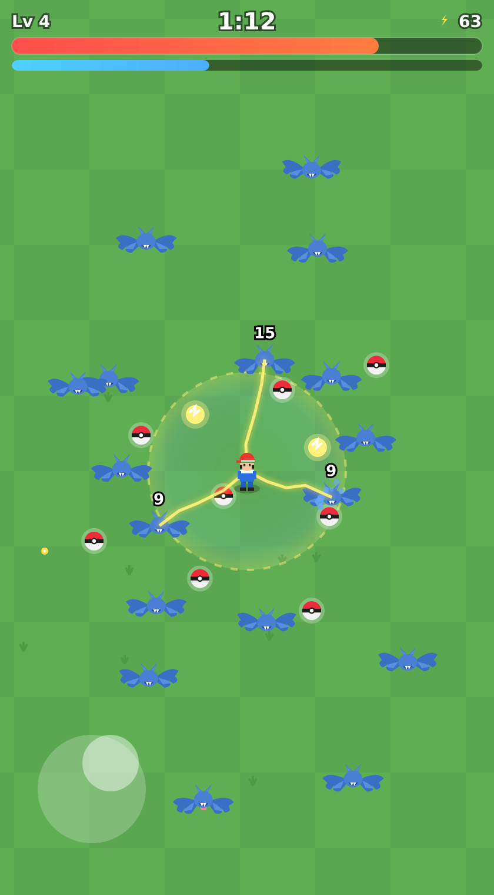
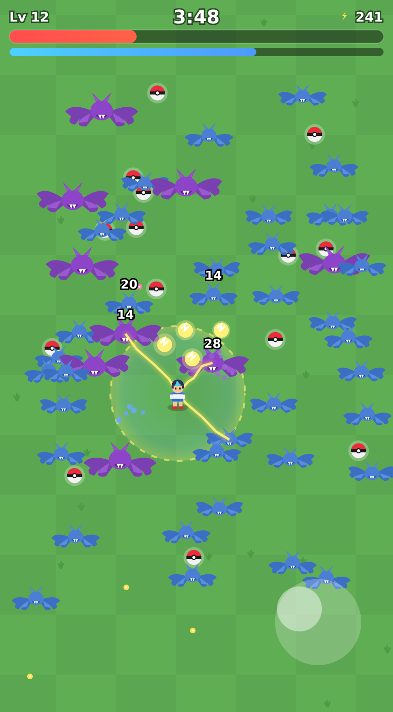

# Pocket Survivors

A Pokémon-themed 2D survival game in the style of *Vampire Survivors*, built to
play in a mobile web browser. Pick a trainer, dodge an ever-growing swarm of
Zubats on the plains, auto-attack, scoop up Poké Balls, and level up.

**▶ Play it:** https://jdonald.github.io/pocket-survivors/

    
    

It's a single self-contained `index.html` — no build step, no dependencies, no
assets to load. Everything (sprites, sound, logic) is drawn/generated in the
browser with the Canvas API and a little WebAudio, so it works offline and loads
instantly.

## How to play

- **Drag anywhere** on the screen to move (a floating virtual joystick follows
  your finger). On desktop, **WASD / arrow keys** also work.
- Your attacks fire **automatically** at the nearest enemy — just focus on
  positioning and survival.
- Collect **Poké Balls** (dropped by defeated enemies) to gain XP. Each level-up
  pauses the game and offers a choice of **3 upgrades**.
- Touching an enemy hurts you. Survive as long as you can.
- 🔊 button (bottom-right) toggles sound.

## Enemies

- **Zubat** — the basic swarmer: fast, weak, endless.
- **Golbat** — a larger, tankier purple variant that starts appearing early and
  hits much harder.
- Periodic **swarm ambushes** drop a big cluster of enemies at once.

## Trainers

Six selectable trainers, each with a different starting edge:

| Trainer | Theme | Starting edge |
|---------|-------|---------------|
| **Ash** | Pikachu | Starts with the **Thunder Shock aura** already active |
| **Misty** | Starmie | Wider Poké Ball magnet + swifter shots |
| **Brock** | Onix | Tanky — more HP and takes less damage (a bit slower) |
| **May** | Blaziken | Faster auto-attacks |
| **Liko** | Sprigatito | Hardy — more HP and slowly heals over time |
| **Goh** | Cinderace | Throws an **extra orb** to catch 'em all |

## Upgrades

Level-up choices include the signature **Thunder Shock** — a crackling electric
aura that zaps and knocks back any enemy that gets close (the requested
"thunder shock aura protection"). Non-Ash trainers can unlock it from the
level-up menu; everyone can stack it to widen the ring and raise its damage and
knockback. Other upgrades cover harder/faster/multi/piercing throws, movement
speed, max HP, pickup magnet range, and HP regen.

## Development history

This game was built conversationally with **Claude Opus 4.8**
(`claude-opus-4-8`), inside the Claude app.

- **≈ June 2026** — Initial build from a single prompt (below).
- **Follow-on tweaks** across the same thread:
  1. Added two more selectable trainers, **Liko** and **Goh**, with graphics
     resembling their Pokémon-anime designs (Liko's dark bob + round glasses +
     glowing pendant; Goh's navy hair with the cyan front swoop).
  2. **Difficulty pass** — the first version was too easy, so enemy spawn rate,
     speed, HP, and contact damage were all turned up: Golbats arrive earlier
     and more often, swarm ambushes are bigger and more frequent, the on-screen
     enemy cap was raised, and post-hit invulnerability was shortened.
- **2026-10-18** — Published to this repository and served via GitHub Pages.

### The original prompt

> Make a 2D mobile game in the same style and gameplay (to play here in Claude
> mobile) as Vampire Survivors (at least its first level on the plains), but the
> characters as more Pokemon-themed (select among Ash, Misty, Brock, or May as
> protagonists… or some that highly resemble them). The enemy bats should be
> like Zubats, gems to pick up replaced by pokeballs, etc. You don't have to
> implement many special powers / upgrades, but there should be one that's like
> a thunder shock aura protection.

*(Dates are approximate — reconstructed from the build sessions.)*

## Tech notes

- Pure HTML + CSS + vanilla JavaScript in one file (`index.html`).
- Rendering: 2D Canvas, device-pixel-ratio aware, resizes to the viewport.
- Input: Pointer Events (unified touch + mouse) with `touch-action: none`.
- Audio: a tiny WebAudio blip synth, resumed on first interaction; mutable.
- No external libraries, fonts, or image files.

## Fan project / attribution

This is a non-commercial fan tribute. *Pokémon* and its characters are
trademarks of Nintendo / Game Freak / The Pokémon Company; *Vampire Survivors*
is by poncle. All sprites here are original simplified renditions drawn with
canvas primitives, not extracted art.

## License

Code is released under the [MIT License](LICENSE). The MIT license covers the
original code in this repository only, not the third-party trademarks referenced
above.
